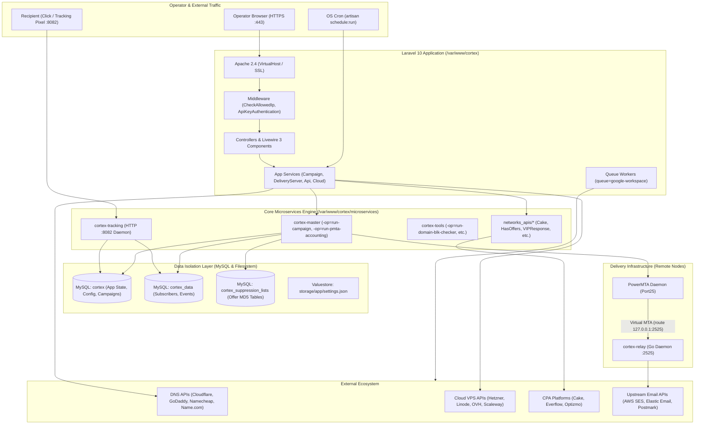

# CORTEX_ARCHITECTURE_CORE.md
**Canonical System Architecture & Engineering Handoff Document**  
**Audit Date:** 2026-10-11  
**Scope:** Read-Only Source Tree & Runtime Topology Inspection (`/var/www/cortex`)  
**Operating Mode:** Read-Only Audit & Architectural Verification

---

## 1. System Mission & Core Operating Principle

**Cortex** is an enterprise-scale email campaign orchestration, deliverability management, and subscriber tracking system. It operates on a **hybrid control and execution model**:
- **Application & Control Plane (PHP 8.1 / Laravel 10):** Handles operator UI (AdminLTE, Livewire 3), role-based permissions (Spatie), infrastructure metadata, campaign definitions, DNS/DKIM lifecycle, and scheduled maintenance.
- **High-Throughput Execution Engine (Compiled 64-bit Go Binaries):** High-performance daemons and CLI workers executing subscriber streaming, hash suppression, SMTP socket delivery, and real-time click/open tracking.
- **Delivery Plane (PowerMTA):** Industrial-grade Mail Transfer Agents (MTAs) managed remotely over SSH and fed via Virtual MTA (`<virtual-mta>`) configurations.

**Non-Negotiable Architecture Principle:**
> Extend the existing system; do not redesign, replace, or build parallel infrastructure. Any future extension must identify and reuse the closest existing Cortex pattern.

---

## 2. Component Topology & Ingress Points



---

## 3. Directory & Module Map

| Path | Purpose & Responsibilities | Key Classes / Files |
|---|---|---|
| [`/var/www/cortex/app/Console/Kernel.php`](file:///var/www/cortex/app/Console/Kernel.php) | Central scheduler definition (1-min, 5-min, 15-min cadences). | [`App\Console\Kernel`](file:///var/www/cortex/app/Console/Kernel.php#L9) |
| [`/var/www/cortex/app/Console/Commands/`](file:///var/www/cortex/app/Console/Commands/) | Artisan scheduled commands. | [`RunCampaign.php`](file:///var/www/cortex/app/Console/Commands/RunCampaign.php), [`TrackingServiceChecker.php`](file:///var/www/cortex/app/Console/Commands/TrackingServiceChecker.php), [`CollectSNSData.php`](file:///var/www/cortex/app/Console/Commands/CollectSNSData.php) |
| [`/var/www/cortex/app/Http/Controllers/`](file:///var/www/cortex/app/Http/Controllers/) | HTTP Request handlers. | [`EmailCampaignController.php`](file:///var/www/cortex/app/Http/Controllers/EmailCampaignController.php), [`DeliveryServerController.php`](file:///var/www/cortex/app/Http/Controllers/DeliveryServerController.php), [`ProviderController.php`](file:///var/www/cortex/app/Http/Controllers/ProviderController.php) |
| [`/var/www/cortex/app/Http/Middleware/`](file:///var/www/cortex/app/Http/Middleware/) | Security, IP validation, and API authentication. | [`CheckAllowedIp.php`](file:///var/www/cortex/app/Http/Middleware/CheckAllowedIp.php), [`ApiKeyAuthentication.php`](file:///var/www/cortex/app/Http/Middleware/ApiKeyAuthentication.php) |
| [`/var/www/cortex/app/Livewire/`](file:///var/www/cortex/app/Livewire/) | Reactive Livewire 3 components. | [`EmailApiProviderManager.php`](file:///var/www/cortex/app/Livewire/EmailApiProviderManager.php), `GoogleWorkspace/*` |
| [`/var/www/cortex/app/Models/`](file:///var/www/cortex/app/Models/) | Eloquent data layer and business rules. | [`EmailCampaign.php`](file:///var/www/cortex/app/Models/EmailCampaign.php), [`DeliveryServer.php`](file:///var/www/cortex/app/Models/DeliveryServer.php), [`DeliveryServerInterface.php`](file:///var/www/cortex/app/Models/DeliveryServerInterface.php), [`EmailThroughApiProvider.php`](file:///var/www/cortex/app/Models/EmailThroughApiProvider.php), [`ApiKey.php`](file:///var/www/cortex/app/Models/ApiKey.php) |
| [`/var/www/cortex/app/Services/Campaign/`](file:///var/www/cortex/app/Services/Campaign/) | Campaign preparation, validation, and execution. | [`EmailCampaignProcessService.php`](file:///var/www/cortex/app/Services/Campaign/EmailCampaignProcessService.php), [`EmailCampaignAuditService.php`](file:///var/www/cortex/app/Services/Campaign/EmailCampaignAuditService.php), [`EmailCampaignManager.php`](file:///var/www/cortex/app/Models/EmailCampaignManager.php) |
| [`/var/www/cortex/app/Services/DeliveryServer/`](file:///var/www/cortex/app/Services/DeliveryServer/) | Server installation, VMTA configuration, DNS sync. | [`Installer.php`](file:///var/www/cortex/app/Services/DeliveryServer/Installer.php), [`PowerMtaConfigGenerator.php`](file:///var/www/cortex/app/Services/DeliveryServer/PowerMtaConfigGenerator.php), [`DomainDnsManagerService.php`](file:///var/www/cortex/app/Services/DeliveryServer/DomainDnsManagerService.php), [`EmailApiProviderManagerService.php`](file:///var/www/cortex/app/Services/DeliveryServer/EmailApiProviderManagerService.php) |
| [`/var/www/cortex/app/Services/Api/`](file:///var/www/cortex/app/Services/Api/) | Outbound DNS & external client services. | [`CloudFlareApiService.php`](file:///var/www/cortex/app/Services/Api/CloudFlareApiService.php), [`GodaddyApiService.php`](file:///var/www/cortex/app/Services/Api/GodaddyApiService.php), [`NameCheapApiService.php`](file:///var/www/cortex/app/Services/Api/NameCheapApiService.php), [`AffiliateNetworkApiManagerService.php`](file:///var/www/cortex/app/Services/Api/AffiliateNetworkApiManagerService.php) |
| [`/var/www/cortex/app/Services/Cloud/`](file:///var/www/cortex/app/Services/Cloud/) | VPS cloud management. | `HetznerManager`, `LinodeManager`, `OvhManager`, `ScalewayManager` |
| [`/var/www/cortex/app/Services/Data/`](file:///var/www/cortex/app/Services/Data/) | Suppression matching and subscriber analytics. | [`SuppressionFileService.php`](file:///var/www/cortex/app/Services/Data/SuppressionFileService.php), [`EmailListInsightsService.php`](file:///var/www/cortex/app/Services/Data/EmailListInsightsService.php) |
| [`/var/www/cortex/microservices/`](file:///var/www/cortex/microservices/) | Compiled Go core binaries and runtime configuration. | `cortex-master`, `cortex-tracking`, `cortex-tools`, `config.ini` |
| [`/var/www/cortex/microservices/networks_apis/`](file:///var/www/cortex/microservices/networks_apis/) | Compiled affiliate network CLI drivers. | `cortex-cake`, `cortex-hasoffers`, `cortex-vipresponse`, `cortex-w4` |
| [`/var/www/cortex/storage/small-server-setup/`](file:///var/www/cortex/storage/small-server-setup/) | Deployment assets transferred to remote delivery nodes. | `home-content/cortex-relay`, `home-content/cortex-relay.service`, `home-content/cortex-engine` |
| [`/var/www/cortex/storage/app/settings.json`](file:///var/www/cortex/storage/app/settings.json) | Central application key-value configuration. | Loaded via singleton `app('settings')` (`Spatie\Valuestore`) |
| [`/var/www/cortex/environment/`](file:///var/www/cortex/environment/) | Operations, backup, and restore shell automation. | [`auto-backup.sh`](file:///var/www/cortex/environment/auto-backup.sh), [`auto-restore.sh`](file:///var/www/cortex/environment/auto-restore.sh) |

---

## 4. Database Topology & Persistence Boundaries

Cortex enforces strict physical data isolation across three MySQL databases configured in [`config/database.php`](file:///var/www/cortex/config/database.php):

1. **`cortex` (Application Control & State):**
   - Tables: `users`, `roles`, `permissions`, `providers`, `sponsors`, `offers`, `offer_creatives`, `delivery_servers`, `delivery_server_interfaces`, `email_campaigns`, `email_campaign_settings`, `email_campaign_statistics`, `api_keys`, `email_through_api_providers`.
   - Role: System configuration, campaign metadata, server interfaces, and aggregated rollups.
2. **`cortex_data` (High-Volume Subscriber & Interaction Store):**
   - Tables: `email_lists`, `email_subscribers`, `email_campaign_engagements`.
   - Role: Bulk subscriber records, custom subscriber attributes, and granular engagement logs (opens, clicks, unsubscribes, leads).
3. **`cortex_suppression_lists` (Compliance & Hash Matching Store):**
   - Dynamic Tables: `offer_supp_{offer_id}` (Generated per offer containing MD5 and plaintext suppression hashes).
   - Global Tables: `global_suppression_lists`.
   - Role: High-speed exclusion matching executed by `cortex-master -op=data-suppression`.

---

## 5. Critical End-to-End Workflows

### 5.1 Campaign Lifecycle & Dispatch Trace
1. **Trigger:** Operator clicks "Publish" or cron triggers [`app/Console/Commands/RunCampaign.php:39-84`](file:///var/www/cortex/app/Console/Commands/RunCampaign.php#L39-L84).
2. **Ingress:** Handled by [`EmailCampaignController::control()`](file:///var/www/cortex/app/Http/Controllers/EmailCampaignController.php#L329-L370).
3. **Splitting:** If multi-server delivery is enabled, [`EmailCampaignManager::splitByServers()`](file:///var/www/cortex/app/Models/EmailCampaignManager.php) partitions the campaign into per-server child campaigns under a common `group_id`.
4. **Compliance Audit:** [`EmailCampaignAuditService::revision()`](file:///var/www/cortex/app/Services/Campaign/EmailCampaignAuditService.php#L16-L125) validates:
   - Test email whitelisting in `allowed_test_emails` (`checkAllowedTestEmails()`).
   - Domain blacklisting for sender identity (`checkBlocklistedDomains()`).
   - Suppression status: `cortex_suppression_lists.offer_supp_{offer_id}` table presence and completed process status.
5. **Payload Compilation:** [`EmailCampaignProcessService::runEmailCampaign()`](file:///var/www/cortex/app/Services/Campaign/EmailCampaignProcessService.php#L27-L65) writes `/var/www/cortex/microservices/campaigns/{id}.json`.
6. **Binary Dispatch:** [`EmailCampaignProcessService::runCore()`](file:///var/www/cortex/app/Services/Campaign/EmailCampaignProcessService.php#L183-L195) calls:
   ```bash
   cd /var/www/cortex/microservices/; sudo nohup ./cortex-master -op=run-campaign -emailCampaignID={id} -emailCampaignRemoveTempFolder=true > /dev/null 2>&1 &
   ```
7. **Delivery Execution:** `cortex-master` connects to `cortex_data`, hashes emails against `cortex_suppression_lists`, injects personalized headers and tracking tokens, connects to PowerMTA over SMTP, and updates `cortex.email_campaigns` progress.

### 5.2 Recipient Tracking & Attribution Trace
1. **Trigger:** Recipient clicks a link (`/rd/{token}`) or renders an image pixel (`/img/{token}`).
2. **Listener:** Standalone Go daemon `cortex-tracking` listening on port 8082 (managed via Supervisor unit `cortex-tracking`).
3. **Evaluation:** Rate limits checked (`[protection] max_clicks_in_minute` in `config.ini`). IP resolved against local MaxMind MMDB database.
4. **Persistence:** Raw interaction logged to `cortex_data.email_campaign_engagements`. Aggregate counters incremented in `cortex.email_campaign_statistics`.
5. **Egress:** Returns HTTP 302 Redirect to destination offer URL or 1x1 transparent GIF.

### 5.3 Automated PowerMTA Accounting & Hygiene Trace
1. **Trigger:** Every 15 minutes via [`app/Console/Kernel.php:66`](file:///var/www/cortex/app/Console/Kernel.php#L66).
2. **Command:** `cortex-master -op=run-pmta-accounting`.
3. **Processing:** Scrapes accounting CSV files from `/home/pmta/accounting/` across all active delivery servers over SSH.
4. **Hygiene Action:** Identifies hard bounces (SMTP 5.x.x codes: `bad-mailbox`, `bad-domain`, `inactive-mailbox`), updates subscriber state in `cortex_data`, and writes logs to `storage/core-cache/logs/pmta-accounting-process/`.

---

## 6. PowerMTA & Provider Delivery Architecture

### 6.1 Two Delivery Paradigms in Cortex

#### Paradigm 1: Direct PowerMTA Virtual MTA Delivery (Standard SMTP)
Used for direct IP sending or standard external SMTP relays:
- **Interface Type:** `INTERFACE_TYPE_SMTP_THROUGH_PMTA = 'smtp-through-pmta'`.
- **Template:** `delivery_server_pmta_smtp_template`.
- **PowerMTA Stanza:**
  ```
  <virtual-mta [tag_name]>
      smtp-source-ip                  [private_ip]
      host-name                       [hostname]
      <domain *>
          route                       [smtp_host]
          default-smtp-port           [smtp_port]
          use-starttls                [smtp_start_tls]
          require-starttls            [smtp_required_tls]
          use-unencrypted-plain-auth  yes
          auth-username               "[smtp_username]"
          auth-password               "[smtp_password]"
      </domain>
  </virtual-mta>
  ```
- **How It Works:** PowerMTA connects directly to the upstream SMTP server, handles socket pooling, TLS, rate limits, and bounces. `cortex-master` injects into PowerMTA via standard local SMTP.

#### Paradigm 2: Local SMTP-to-HTTP API Relay Daemon (`cortex-relay`)
Used for API-backed providers (Elastic Email, Amazon SES, Postmark, Google Workspace):
- **Interface Types:** `elastic-mail`, `aws-ses-api`, `postmark-api`, `gmail-api-through-pmta`, `google-workspace-api-through-pmta`.
- **Template:** `delivery_server_pmta_smtp_relay_template` (or `pmta_gc_template`).
- **PowerMTA Stanza:**
  ```
  <virtual-mta [tag_name]>
      smtp-source-ip      [private_ip]
      host-name           [hostname]
      <domain *>
          log-connections no
          log-commands    no
          route 127.0.0.1:2525 # smtp relay
      </domain>
  </virtual-mta>
  ```
- **How It Works:** PowerMTA routes the outbound email locally to `127.0.0.1:2525`. On port 2525, `cortex-relay` accepts the SMTP connection, identifies the provider and credentials from `dyn_relation` / `interface_data`, and calls the provider's HTTP REST API (`*ses.Client`, Google API, Elastic, Postmark).

### 6.2 The `EmailApiProviderManagerService` Mapping Convention
In [`app/Services/DeliveryServer/EmailApiProviderManagerService.php:34-36`](file:///var/www/cortex/app/Services/DeliveryServer/EmailApiProviderManagerService.php#L34-L36):
```php
$newInterface->ex_smtp_from_email = $provider->default_from_email;
$newInterface->ex_smtp_host = $provider->default_from_email;
$newInterface->ex_smtp_username = $provider->default_from_email;
```
- **Audit Finding:** Setting `ex_smtp_host` to the sender email address is an intentional schema convention shared across all API sync services (`GoogleCredentialServerSync.php`, `GoogleWorkspaceUserServerSync.php`).
- **Reason:** For Paradigm 2, PowerMTA routes to `127.0.0.1:2525`. The template does not contain `[smtp_host]`.
- **Safety Rule for Extensions:** If adding an SMTP provider that relies on Paradigm 1 (Direct SMTP via `delivery_server_pmta_smtp_template`), `ex_smtp_host` **must contain the actual remote SMTP host** (e.g. `smtp.sendgrid.net`), not an email address.

---

## 7. Existing Engineering Patterns & Reusable Extension Points

1. **Inbound API Authorization Pattern:**
   - Middleware: [`app/Http/Middleware/ApiKeyAuthentication.php`](file:///var/www/cortex/app/Http/Middleware/ApiKeyAuthentication.php) verifying `X-API-Key` header against `api_keys` table.
   - Route file: [`routes/api.php`](file:///var/www/cortex/routes/api.php).
   - Permission validation: [`ApiKey::hasPermission($scope)`](file:///var/www/cortex/app/Models/ApiKey.php#L85-L88).
2. **Outbound Provider API Service Pattern (Reference: Cloudflare):**
   - Location: [`app/Services/Api/CloudFlareApiService.php`](file:///var/www/cortex/app/Services/Api/CloudFlareApiService.php).
   - Characteristics: Custom cURL client (`curl_setopt_array`), Bearer token auth, explicit `CURLINFO_HTTP_CODE` validation, pagination handling, non-fatal error logging.
3. **Cloud VPS Provisioning Pattern:**
   - Location: [`app/Services/Cloud/{Provider}CloudAPI/`](file:///var/www/cortex/app/Services/Cloud/).
   - Characteristics: Dedicated Manager class extending standard driver helpers (`ApiDriverHelper`, `Requester`).
4. **Affiliate CPA Network Driver Pattern:**
   - Location: [`app/Services/Api/AffiliateNetworkApiManagerService.php`](file:///var/www/cortex/app/Services/Api/AffiliateNetworkApiManagerService.php).
   - Execution: Delegates heavy lifting to compiled CLI binaries in `microservices/networks_apis/` via `-op=get-suppression-link`, `-op=add-offers`, `-op=get-conversion-report`.

---

## 8. Security & Reliability Boundaries

1. **IP Whitelisting Barrier:** [`app/Http/Middleware/CheckAllowedIp.php`](file:///var/www/cortex/app/Http/Middleware/CheckAllowedIp.php) terminates requests with HTTP 403 if `enable_app_allowed_ips` is active and caller IP does not match `app_allowed_ips` or DDNS hosts.
2. **Test Email Isolation Barrier:** [`EmailCampaignAuditService::checkAllowedTestEmails()`](file:///var/www/cortex/app/Services/Campaign/EmailCampaignAuditService.php#L127-L140) blocks campaign dispatch if preview/test recipients are not registered in `allowed_test_emails`.
3. **Suppression Enforcement Barrier:** Campaign dispatch is strictly blocked unless `cortex_suppression_lists.offer_supp_{offer_id}` table exists and suppression process is marked `DONE_FLAG`.
4. **Missing Automated Test Harness:** No `tests/` directory exists in the production workspace. All regression verification must occur in an isolated clone.
5. **Unescaped Shell Variables:** Several console commands construct shell strings without wrapping all path components in `escapeshellarg()`. Any new command must strictly escape all shell parameters.
