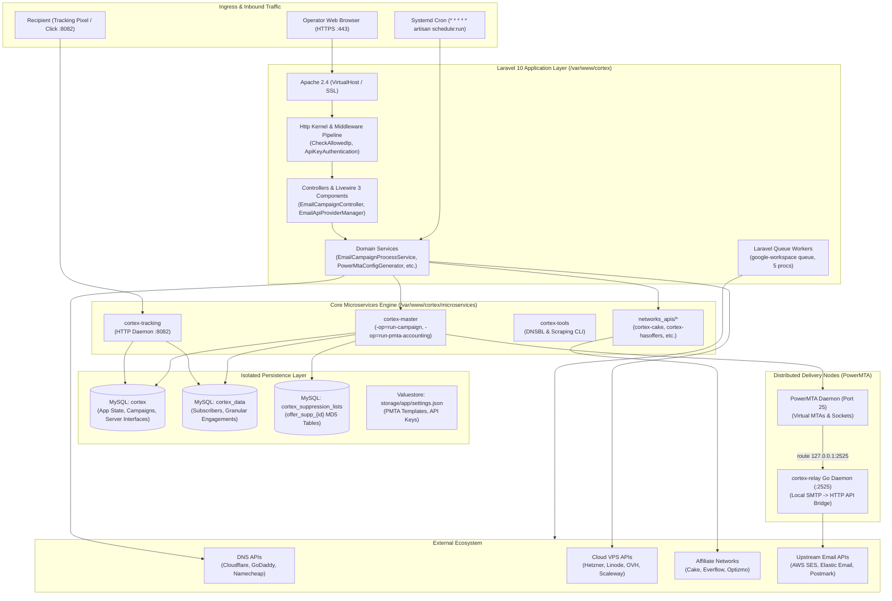
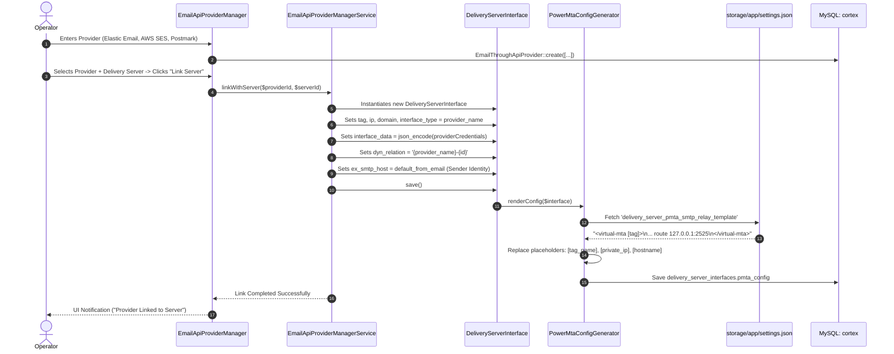
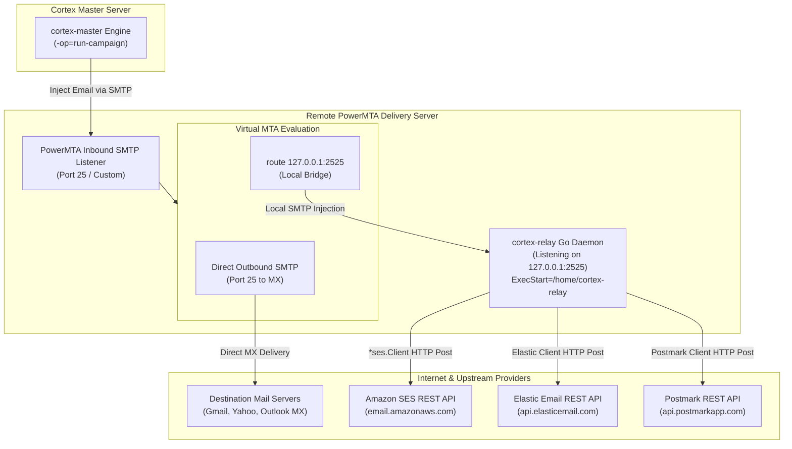
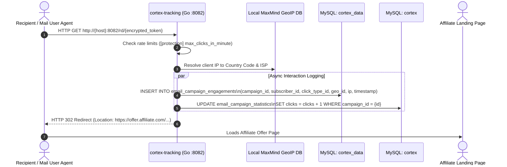
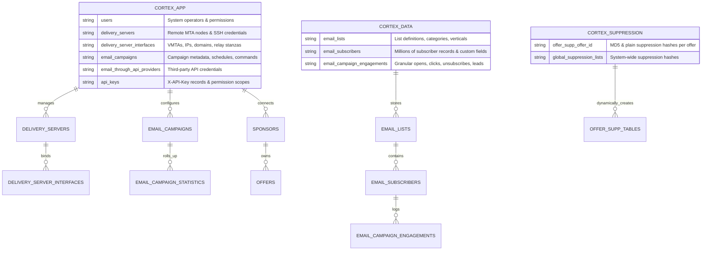

# CORTEX_ARCHITECTURE_DIAGRAMS.md
**Visual Architecture, Execution Flows & Boundary Maps**  
**Audit Date:** 2026-10-11  
**Operating Mode:** Read-Only Verified Documentation

---

## 1. System Component Topology & Boundaries



---

## 2. Campaign Lifecycle Sequence (Creation to Dispatch)

```mermaid
sequenceDiagram
    autonumber
    actor Admin as Operator / Cron
    participant Web as EmailCampaignController
    participant Audit as EmailCampaignAuditService
    participant Process as EmailCampaignProcessService
    participant DB as MySQL (cortex / cortex_suppression_lists)
    participant Engine as cortex-master (Go Binary)
    participant MTA as PowerMTA Delivery Server

    Admin->>Web: POST /emailCampaigns/control/{id} (action='publish')
    Web->>Audit: revision($campaignData, $userId)
    
    Audit->>DB: Query allowed_test_emails (Whitelist Check)
    Audit->>DB: Query blacklists (Domain Reputation Check)
    Audit->>DB: Check table cortex_suppression_lists.offer_supp_{offer_id}
    
    alt Audit Checks Fail
        Audit-->>Web: auditPassed = false + error message
        Web-->>Admin: Abort dispatch with notification
    else Audit Checks Pass
        Audit-->>Web: auditPassed = true
        Web->>Process: runEmailCampaign($campaign)
        Process->>Process: Compile parameters & custom tags
        Process->>Process: Write /var/www/cortex/microservices/campaigns/{id}.json
        Process->>Engine: exec("cd microservices; sudo nohup ./cortex-master -op=run-campaign -emailCampaignID={id} &")
        Process-->>Web: Return success = true
        Web-->>Admin: Return HTTP 200 (Campaign Running)
        
        par Background Sending Execution
            Engine->>DB: Stream subscriber rows from cortex_data.email_subscribers
            Engine->>DB: Match MD5 hashes against cortex_suppression_lists.offer_supp_{id}
            Engine->>Engine: Embed tracking tokens & personalized headers
            Engine->>MTA: Inject messages into Virtual MTAs over SMTP
            Engine->>DB: Update cortex.email_campaigns (progress, messages_sent)
        end
    end
```

---

## 3. Provider Configuration & Relay Link Sequence



---

## 4. PowerMTA Delivery & `cortex-relay` Bridge



---

## 5. Recipient Tracking & Engagement Attribution



---

## 6. Physical Database Partitioning & Ownership Boundaries


